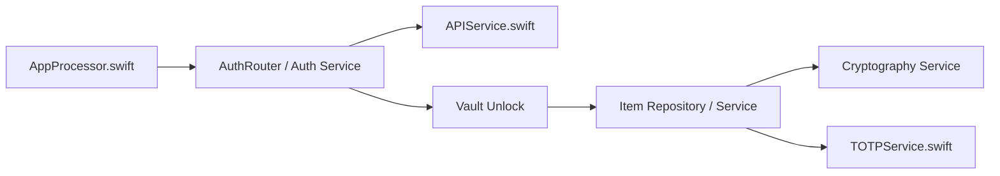

# bitwarden/ios

> Source code of the Bitwarden iOS apps (password manager) and Authenticator.

## The problem
Keep passwords and TOTP codes encrypted and synced on iPhone, with autofill.

## What it actually does
The README does not detail features: it points to the contribution documentation and presents related projects (server, clients, directory-connector). From the code: app orchestration, authentication, vault unlock, encryption, TOTP, import/export, autofill, Action and Share extensions, Watch sync, and the Authenticator app with encrypted storage.

## How it is wired

## Trying it
The README gives no command: the iOS build guide is in the external contribution documentation.

## Cost and gotchas
A Bitwarden account and the server (hosted or self-hosted) are required. Built with Xcode. The repo has 135 open issues.

## What it is not
It is not the server nor the desktop/web clients (other repos). The README is short and points elsewhere.

## Alternatives
- bitwarden/server: the backend.
- bitwarden/clients: non-mobile clients.

## For you
Ignore: mobile password-manager app, unrelated to data/AI/MLOps work.
