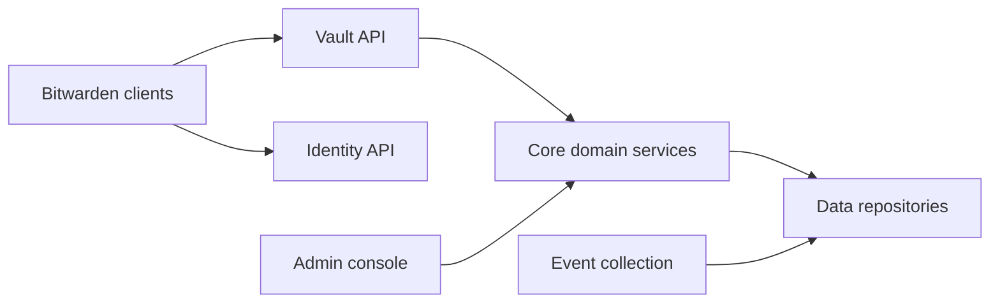

# bitwarden/server

> Backend (API, identity, database) of all Bitwarden clients, self-hostable.

## The problem
Self-hosting a team password manager requires the whole server behind the clients.

## What it actually does
C#/ASP.NET Core API with a T-SQL/SQL Server database: vault, identity, SSO, SCIM, admin console, billing, providers, events, notifications, vault security tasks. Deployment via Docker with Bash and PowerShell scripts.

## How it is wired


## Trying it
```bash
curl -s -L -o bitwarden.sh \
    "https://func.bitwarden.com/api/dl/?app=self-host&platform=linux" \
    && chmod +x bitwarden.sh
./bitwarden.sh install
./bitwarden.sh start
```

## Cost and gotchas
Docker and Docker Compose required. License present but not identified by GitHub: check the terms, notably for enterprise features. A script is downloaded and run as is.

## What it is not
Not a client: this repo contains only the server.

## Alternatives
None named in the README.

## For you
Watch: useful if you want to self-manage a team's secrets, outside the data / AI core business.
