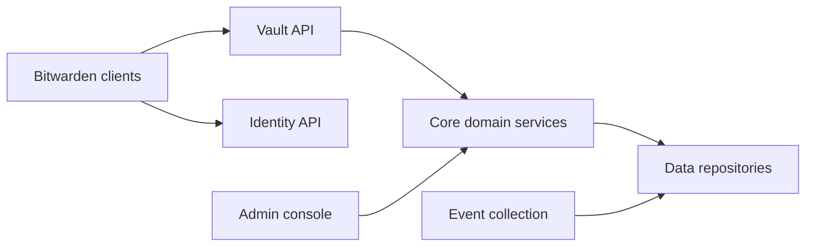

# bitwarden/server

> Backend (API, identité, base de données) de tous les clients Bitwarden, auto-hébergeable.

## Le problème
Héberger soi-même un gestionnaire de mots de passe d'équipe demande tout le serveur derrière les clients.

## Ce que ça fait vraiment
API en C#/ASP.NET Core avec base T-SQL/SQL Server : coffre, identité, SSO, SCIM, console d'administration, facturation, fournisseurs, événements, notifications, tâches de sécurité du coffre. Déploiement via Docker avec scripts Bash et PowerShell.

## Comment c'est branché


## Essayer
```bash
curl -s -L -o bitwarden.sh \
    "https://func.bitwarden.com/api/dl/?app=self-host&platform=linux" \
    && chmod +x bitwarden.sh
./bitwarden.sh install
./bitwarden.sh start
```

## Coût et pièges
Docker et Docker Compose requis. Licence présente mais non identifiée par GitHub : vérifier les conditions, notamment pour les fonctions entreprise. Un script téléchargé et exécuté tel quel.

## Ce que ce n'est pas
Pas un client : ce dépôt ne contient que le serveur.

## Alternatives
Aucune nommée dans le README.

## Pour toi
Surveiller : utile si tu veux gérer toi-même les secrets d'une équipe, hors cœur de métier data / IA.

