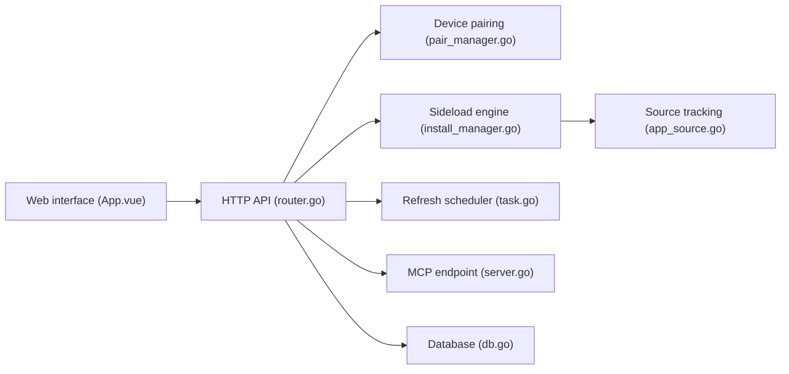

# bitxeno/atvloadly

> Web service to install and refresh apps on Apple TV by sideloading, on Linux or OpenWrt.

## The problem
Installing an IPA app on Apple TV outside the App Store expires quickly with a free account and requires an Apple machine.

## What it actually does
Go service with a Vue interface: Apple TV discovery and pairing, IPA installation via Impactor (sideloading core), scheduled automatic refresh, multiple Apple ID accounts, source tracking (GitHub releases, AltStore sources). It exposes `/healthcheck` and an `/mcp` endpoint so an agent can install or refresh apps.

## How it is wired


## Trying it
```bash
docker run --security-opt seccomp:unconfined -d --name=atvloadly --restart=always -p 5533:80 -v /path/to/mount/dir:/data -v /var/run/dbus:/var/run/dbus -v /var/run/avahi-daemon:/var/run/avahi-daemon bitxeno/atvloadly:latest
```
(`avahi-daemon` must be installed on the host.)

## Cost and gotchas
Free. The README recommends a throwaway Apple ID ("burned account") and a phone for 2FA; account freeze risks are acknowledged. Free account: 3 active apps maximum.

## What it is not
Works neither on Mac nor on Windows. An Apple TV system update requires re-pairing; IPAs requiring CloudKit crash with a free account.

## Alternatives
No alternative named in the README.

## For you
Ignore: an entertainment utility unrelated to data/AI/MLOps, with a risk to your Apple account.
