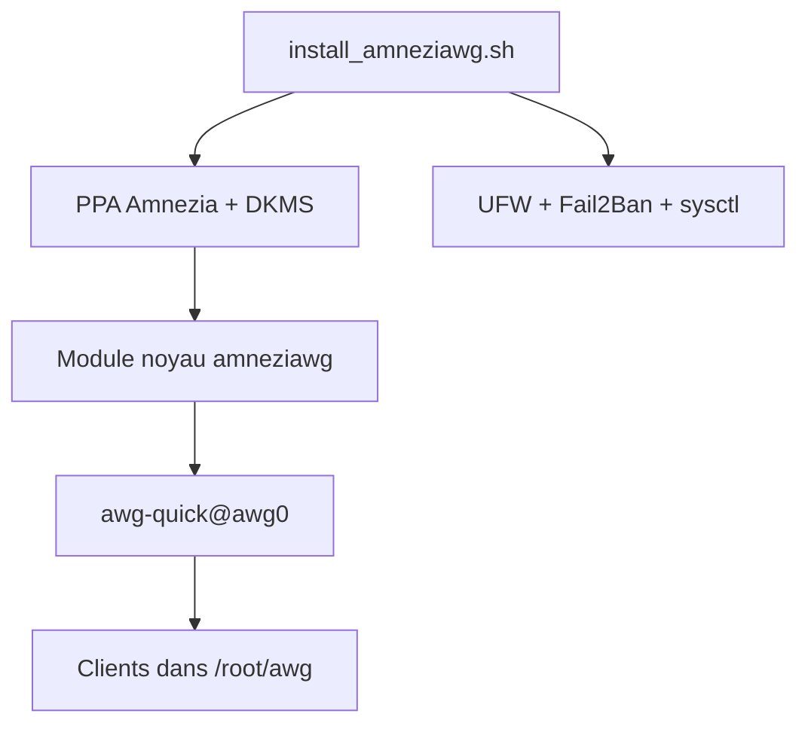

# bivlked/amneziawg-installer

> Bash script that turns an Ubuntu or Debian VPS into an AmneziaWG 3.1 or 2.0 VPN server, obfuscated against DPI.

## The problem
WireGuard is detected and blocked by packet inspection in some countries; setting up an obfuscated server by hand takes a long time.

## What it actually does
The script, run as root, updates the system, removes packages, installs the `amneziawg` kernel module via DKMS (Amnezia PPA), tunes sysctl, swap, UFW and Fail2Ban, then creates two clients (`my_phone`, `my_laptop`) with configuration files, QR codes and `vpn://` links. It handles adding clients, temporary clients, statistics and uninstallation. The README is in Russian, with an English version.

## How it is wired
Simplified diagram based on the sheet, no diagram provided.



## Trying it
```bash
wget -O install_amneziawg.sh https://github.com/bivlked/amneziawg-installer/releases/latest/download/install_amneziawg.sh
chmod +x install_amneziawg.sh
sudo bash ./install_amneziawg.sh
```

## Cost and gotchas
A VPS at your expense and a server dedicated to the VPN. The script removes packages (including `unattended-upgrades` and `snapd`) and requires two reboots. Uninstallation does not restore the swap or the removed packages.

## What it is not
Not a web panel nor a multi-protocol tool: AmneziaWG only, on the command line. Not for a router or shared hosting.

## Alternatives
wiresock/amneziawg-install: with a native web panel. wg-easy: Docker and web interface. Amnezia VPN: graphical application.

## For you
Ignore: a network tool to circumvent censorship, outside the data / AI / MLOps scope; it deeply modifies the server.
