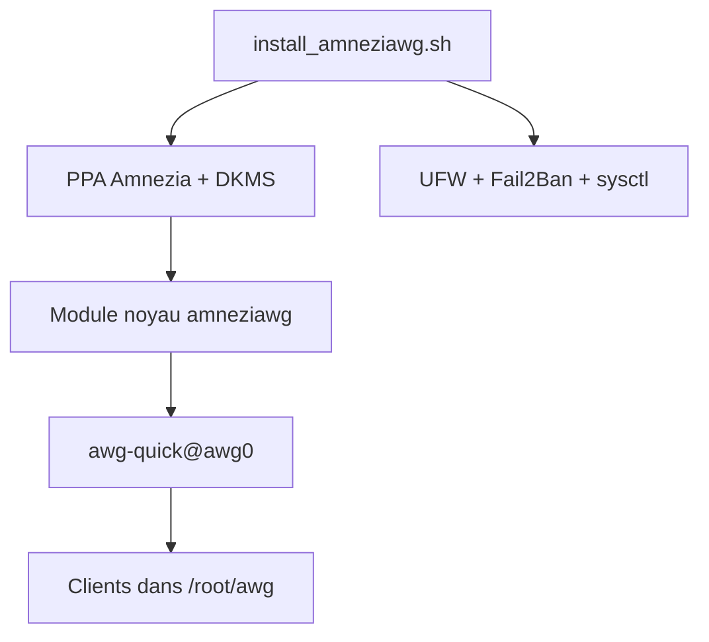

# bivlked/amneziawg-installer

> Script bash qui transforme un VPS Ubuntu ou Debian en serveur VPN AmneziaWG 3.1 ou 2.0, obfusqué contre le DPI.

## Le problème
WireGuard est détecté et bloqué par l'inspection de paquets dans certains pays ; monter à la main un serveur obfusqué est long.

## Ce que ça fait vraiment
Le script, lancé en root, met le système à jour, retire des paquets, installe le module noyau `amneziawg` via DKMS (PPA Amnezia), règle sysctl, swap, UFW et Fail2Ban, puis crée deux clients (`my_phone`, `my_laptop`) avec fichiers de configuration, QR codes et liens `vpn://`. Il gère l'ajout de clients, les clients temporaires, les statistiques et la désinstallation. Le README est en russe, avec version anglaise.

## Comment c'est branché
Schéma simplifié d'après la fiche, sans diagramme fourni.



## Essayer
```bash
wget -O install_amneziawg.sh https://github.com/bivlked/amneziawg-installer/releases/latest/download/install_amneziawg.sh
chmod +x install_amneziawg.sh
sudo bash ./install_amneziawg.sh
```

## Coût et pièges
Un VPS à ta charge et un serveur dédié au VPN. Le script supprime des paquets (dont `unattended-upgrades` et `snapd`) et demande deux redémarrages. La désinstallation ne restaure pas le swap ni les paquets retirés.

## Ce que ce n'est pas
Pas un panneau web ni un multi-protocoles : uniquement AmneziaWG, en ligne de commande. Pas pour un routeur ni un hébergement mutualisé.

## Alternatives
wiresock/amneziawg-install : avec panneau web natif. wg-easy : Docker et interface web. Amnezia VPN : application graphique.

## Pour toi
À ignorer : un outil réseau pour contourner la censure, hors périmètre data / IA / MLOps ; il modifie profondément le serveur.

