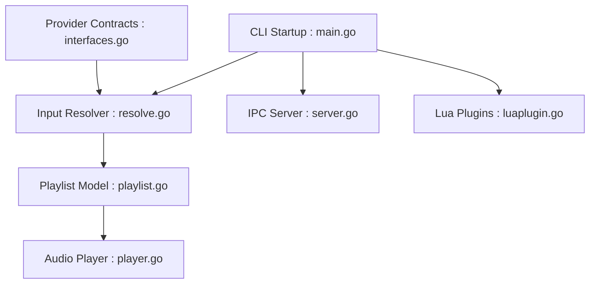

# bjarneo/cliamp

> Retro terminal music player inspired by Winamp, with many local and remote sources.

## The problem
Listen to files, radios, podcasts and streaming services from a terminal.

## What it actually does
Go player (Bubbletea) with a spectrum visualizer, parametric equalizer and playlist manager. Sources: files, streams, podcasts, radio, YouTube via yt-dlp, Spotify via go-librespot, Navidrome, Plex, Jellyfin and others. Remote control, Lua plugins and media keys.

## How it is wired


## Trying it
```bash
brew install bjarneo/cliamp/cliamp
cliamp ~/Music
cliamp https://example.com/stream
cliamp setup
```

## Cost and gotchas
Free. ffmpeg and yt-dlp optional depending on formats. On Windows, Spotify requires CGO and MinGW to build. Installation via `curl | sh` is offered: read it before running. README apparently truncated at the end.

## What it is not
Not a work tool: an audio player, unrelated to data/AI.

## Alternatives
No alternative named in the README.

## For you
Ignore: pleasant for listening to music in a terminal, but of no value for a data/AI/MLOps profile.
