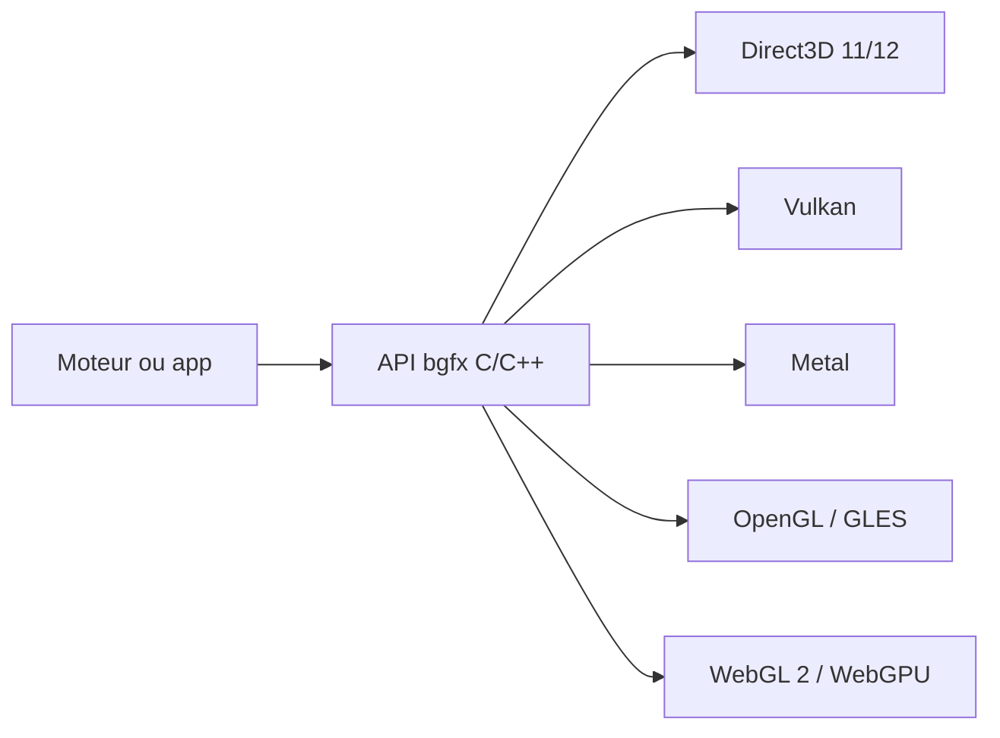

# bkaradzic/bgfx

> Cross-platform, API-agnostic graphics rendering library, to plug into your own engine.

## The problem
A graphics engine or application has to handle Direct3D, Metal, Vulkan and OpenGL, each with its own API.

## What it actually does
Provides a single C/C++ API that translates to several backends: Direct3D 11 and 12, Metal, OpenGL 4.3+, OpenGL ES 3.0+, Vulkan, WebGL 2.0, WebGPU (Dawn Native only), GNM for licensed PS4 developers. Targets Android, iOS, Linux, macOS, PlayStation 4, Raspberry Pi, UWP, Wasm/Emscripten and Windows. Bindings exist for C#, Python, Go, Rust, Java, Lua, Zig, Swift, etc. The README mostly lists games and projects that use it.

## How it is wired

## Trying it
No command documented in the excerpt: the README points to the API documentation.

## Cost and gotchas
Free, BSD-2-Clause. Required compilers: Clang 11+, GCC 11+, VS2022+, Apple clang 12+. The GNM backend is only available to licensed PS4 developers.

## What it is not
Not a game engine: the application supplies its own engine ("Bring Your Own Engine/Framework"). Not a data visualization tool.

## Alternatives
None named in the README, apart from projects that use it (e.g. Crown, Torque6).

## For you
Ignore: a real-time rendering library for games and engines, with no application to data/AI/MLOps work.
