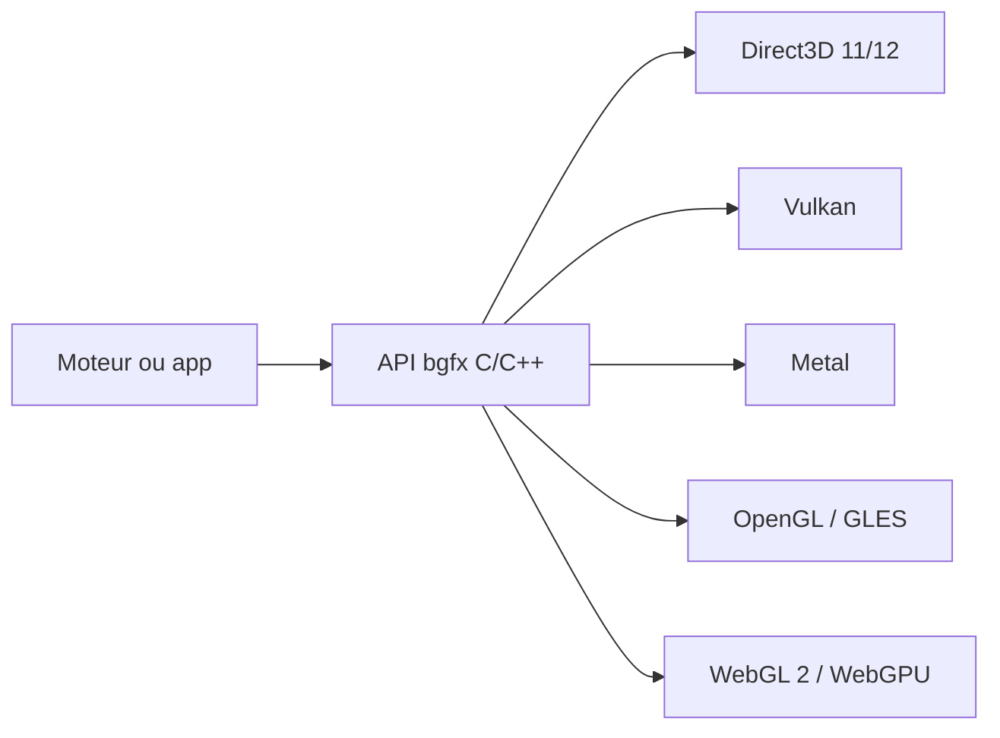

# bkaradzic/bgfx

> Bibliothèque de rendu graphique multiplateforme, indépendante de l'API, à brancher sur son propre moteur.

## Le problème
Un moteur ou une application graphique doit gérer Direct3D, Metal, Vulkan et OpenGL, chacun avec son API.

## Ce que ça fait vraiment
Fournit une API C/C++ unique qui traduit vers plusieurs backends : Direct3D 11 et 12, Metal, OpenGL 4.3+, OpenGL ES 3.0+, Vulkan, WebGL 2.0, WebGPU (Dawn Native seulement), GNM pour développeurs PS4 licenciés. Cible Android, iOS, Linux, macOS, PlayStation 4, Raspberry Pi, UWP, Wasm/Emscripten et Windows. Des liaisons existent pour C#, Python, Go, Rust, Java, Lua, Zig, Swift, etc. Le README liste surtout des jeux et projets qui l'utilisent.

## Comment c'est branché

## Essayer
Aucune commande documentée dans l'extrait : le README renvoie à la documentation de l'API.

## Coût et pièges
Gratuit, BSD-2-Clause. Compilateurs requis : Clang 11+, GCC 11+, VS2022+, Apple clang 12+. Le backend GNM n'est accessible qu'aux développeurs PS4 sous licence.

## Ce que ce n'est pas
Pas un moteur de jeu : l'application fournit son propre moteur (« Bring Your Own Engine/Framework »). Pas d'outil de visualisation de données.

## Alternatives
Aucune nommée dans le README, hors projets qui l'utilisent (par ex. Crown, Torque6).

## Pour toi
Ignorer : bibliothèque de rendu temps réel pour jeux et moteurs, sans application pour le travail data/IA/MLOps.

