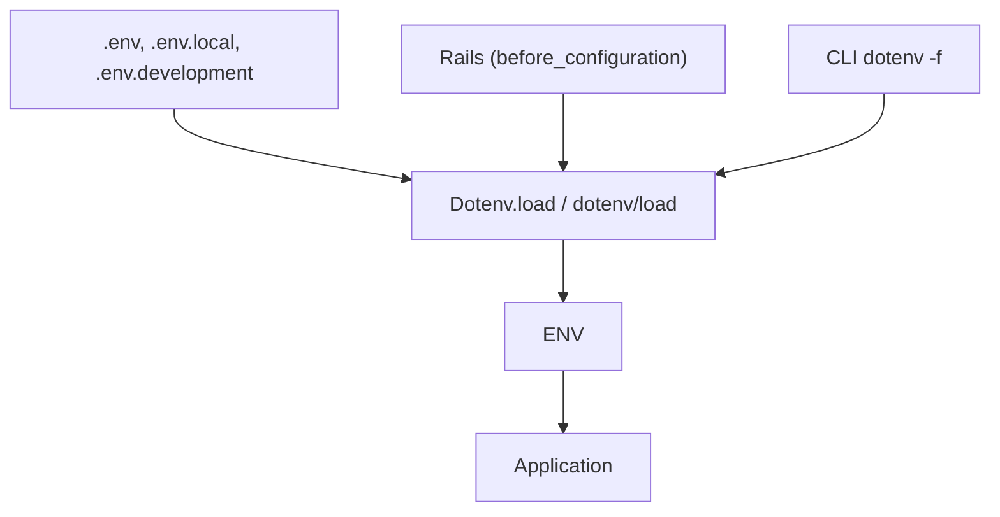

# bkeepers/dotenv

> Ruby gem that loads a `.env` file into `ENV` for development, aimed at Rails developers.

## The problem
Configuration variables change depending on the environment, and setting them by hand on every workstation or integration server is tedious.

## What it actually does
Reads `.env` (and variants `.env.local`, `.env.development`...) and fills `ENV` at startup. Does not override an already defined variable, unless `overwrite: true`. Handles multi-line values, variable substitution, `$(...)` commands, required keys, a CLI executable and templates.

## How it is wired
Simplified diagram based on the fiche, no diagram provided.



## Trying it
```bash
bundle install
dotenv ./script.rb
dotenv -f ".env.local,.env" ./script.rb
```

## Cost and gotchas
No cost. Do not commit secrets; by default existing variables win. In production, the README recommends better ways to manage configuration.

## What it is not
Not a secrets manager. Written for Ruby: outside the Ruby ecosystem, it is useless.

## Alternatives
No alternative named in the README.

## For you
Worth watching only if you touch Ruby: a Python data scientist has no use for it, even though the principle is widespread.
