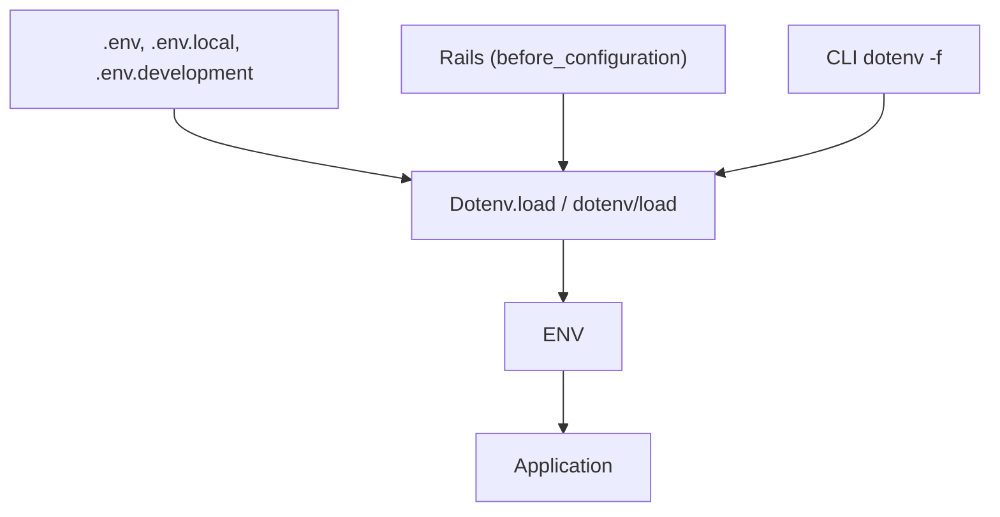

# bkeepers/dotenv

> Gem Ruby qui charge un fichier `.env` dans `ENV` pour le développement, pour les développeurs Rails.

## Le problème
Les variables de configuration changent selon l'environnement, et les définir à la main sur chaque poste ou serveur d'intégration est pénible.

## Ce que ça fait vraiment
Lit `.env` (et variantes `.env.local`, `.env.development`...) et remplit `ENV` au démarrage. Ne remplace pas une variable déjà définie, sauf `overwrite: true`. Gère multi-lignes, substitution de variables, commandes `$(...)`, clés obligatoires, exécutable CLI et gabarits.

## Comment c'est branché
Schéma simplifié d'après la fiche, sans diagramme fourni.



## Essayer
```bash
bundle install
dotenv ./script.rb
dotenv -f ".env.local,.env" ./script.rb
```

## Coût et pièges
Aucun coût. Ne pas committer de secrets ; par défaut les variables existantes gagnent. En production, le README recommande de meilleurs moyens de gérer la configuration.

## Ce que ce n'est pas
Pas un gestionnaire de secrets. Écrit pour Ruby : hors écosystème Ruby, il ne sert à rien.

## Alternatives
Aucune alternative nommée dans le README.

## Pour toi
À surveiller seulement si tu touches du Ruby : un data scientist Python n'en a pas l'usage, même si le principe est répandu.

