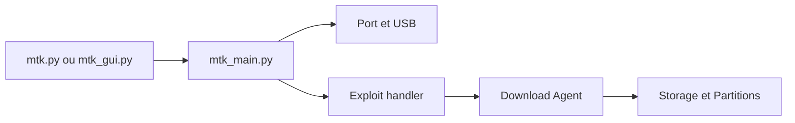

# bkerler/mtkclient

> PC tool to read, write and unlock the memory of MediaTek phones over USB, using bootrom exploits.

## The problem
Backing up, restoring or unlocking a MediaTek device requires low-level access that vendor tools do not provide.

## What it actually does
A Python program (`mtk.py` CLI, `mtk_gui.py` Qt interface, API and TCP client/server) that detects the chip, picks an exploit (kamakiri, amonet, heapbait...) or a preloader, sends a download agent and reads or writes the flash and partitions. Recent chips (protocol V6) require a suitable loader and preloader mode.

## How it is wired

## Trying it
The README points to installation and usage pages without reproducing them. The only command cited: run the `mtk` tool with `--debugmode` to write `log.txt`.

## Cost and gotchas
Windows: original MTK port and USBDK driver; Linux: patched kernel for the old kamakiri. Writing to the flash can render the device unusable; reserve it for your own hardware.

## What it is not
Neither a consumer backup tool nor a risk-free utility: it relies on exploits.

## Alternatives
No alternative named in the README.

## For you
Ignore: low-level tool for mobile devices, GPL-3.0, no use in a data or MLOps workflow.
