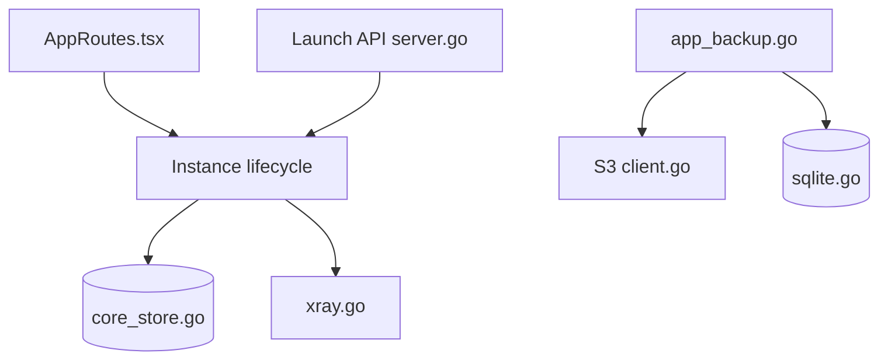

# black-ant/Ant-Browser

> Desktop browser that isolates profiles, each with its own proxy and core, for multiple accounts.

## The problem
Managing several accounts (cross-border e-commerce, social networks, testing) without mixing environments and exit IPs.

## What it actually does
Creates and launches isolated browser instances, each tied to a proxy from the pool (Xray plus sing-box, or Mihomo, never mixed) and to a fingerprint Chrome core (fingerprint-chromium recommended). Adds `Ctrl + K` shortcuts, automation scripts, plugins, instance import/export, a launch API and backups (local, OpenList, S3). README in Chinese.

## How it is wired


## Trying it
```bash
bat\dev.bat
./scripts/dev.sh
bash publish/linux/publish-linux.sh --arch amd64
```
For users: download the installer or the portable ZIP from Releases.

## Cost and gotchas
Free. You must supply proxies and prepare a Chrome core (`chrome.exe` for Windows). 8 GB of RAM recommended. The macOS build is unsigned. No license declared on the repository.

## What it is not
Not a security tool nor a guaranteed anonymity tool: the README recommends checking the exit IP. Multi-account use may violate the terms of the targeted platforms.

## Alternatives
fingerprint-chromium, cited in the README as the recommended core (a complementary building block, not a competitor).

## For you
Ignore: multi-account operations tool unrelated to data/AI/MLOps, with no declared license.
