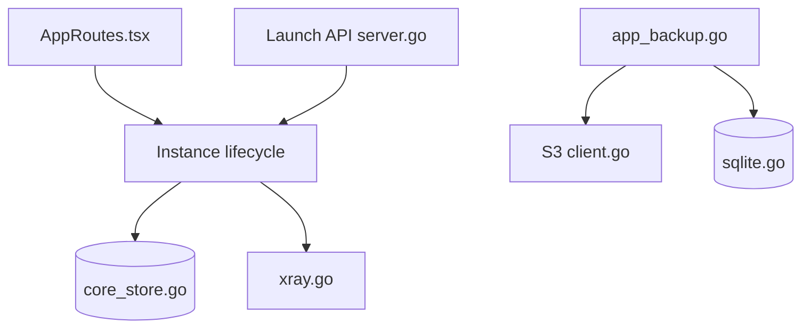

# black-ant/Ant-Browser

> Navigateur de bureau qui isole des profils, chacun avec son proxy et son noyau, pour comptes multiples.

## Le problème
Gérer plusieurs comptes (e-commerce transfrontalier, réseaux sociaux, tests) sans que les environnements et les sorties IP se mélangent.

## Ce que ça fait vraiment
Crée et lance des instances de navigateur isolées, chacune liée à un proxy du pool (Xray plus sing-box, ou Mihomo, sans mélange) et à un noyau Chrome d'empreinte (fingerprint-chromium recommandé). Ajoute raccourcis `Ctrl + K`, scripts d'automatisation, plugins, import/export d'instances, API de lancement et sauvegardes (local, OpenList, S3). README en chinois.

## Comment c'est branché


## Essayer
```bash
bat\dev.bat
./scripts/dev.sh
bash publish/linux/publish-linux.sh --arch amd64
```
Pour les utilisateurs : télécharger l'installeur ou le ZIP portable depuis Releases.

## Coût et pièges
Gratuit. Il faut fournir des proxys et préparer un noyau Chrome (`chrome.exe` pour Windows). 8 Go de RAM conseillés. Build macOS non signé. Aucune licence déclarée sur le dépôt.

## Ce que ce n'est pas
Pas un outil de sécurité ni d'anonymat garanti : le README recommande de vérifier l'IP de sortie. L'usage multi-comptes peut contrevenir aux conditions des plateformes visées.

## Alternatives
fingerprint-chromium, cité dans le README comme noyau recommandé (brique complémentaire, pas un concurrent).

## Pour toi
Ignorer : outil d'opérations multi-comptes sans lien avec data/IA/MLOps, sans licence déclarée.

