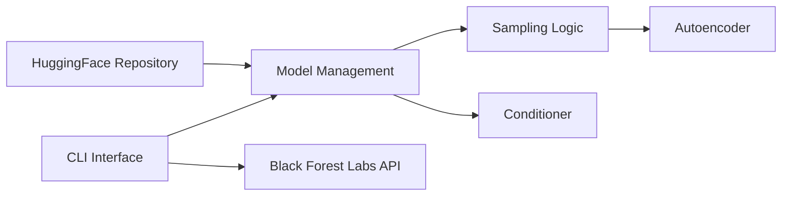

# black-forest-labs/flux

> Minimal inference code for the open-weight FLUX models to generate and edit images.

## The problem
Using the FLUX weights locally requires reliable reference code for generation, inpainting and structural conditioning.

## What it actually does
Python CLI (`python -m flux ...`) and demos for FLUX.1 schnell, dev, Fill, Canny, Depth, Redux, Kontext, Krea.
Weights on Hugging Face; autoencoder under Apache-2.0.
Usage tracking via the BFL API (`--track_usage`) for commercial use of the dev models.
Access to Pro models through a separate paid API.

## How it is wired


## Trying it
```bash
cd $HOME && git clone https://github.com/black-forest-labs/flux
cd $HOME/flux
python3.10 -m venv .venv
source .venv/bin/activate
pip install -e ".[all]"
python -m flux kontext --track_usage --prompt "replace the logo with the text 'Black Forest Labs'"
```

## Cost and gotchas
Apache-2.0 code but most "dev" weights are non-commercial: paid license and usage reporting via the `BFL_API_KEY` key. GPU required.

## What it is not
Not an application. Only schnell is freely usable commercially. Last push July 2025.

## Alternatives
No alternative named in the README.

## For you
Watch: useful reference code for testing FLUX, but the weights' commercial clauses make it a trap for any client use.
