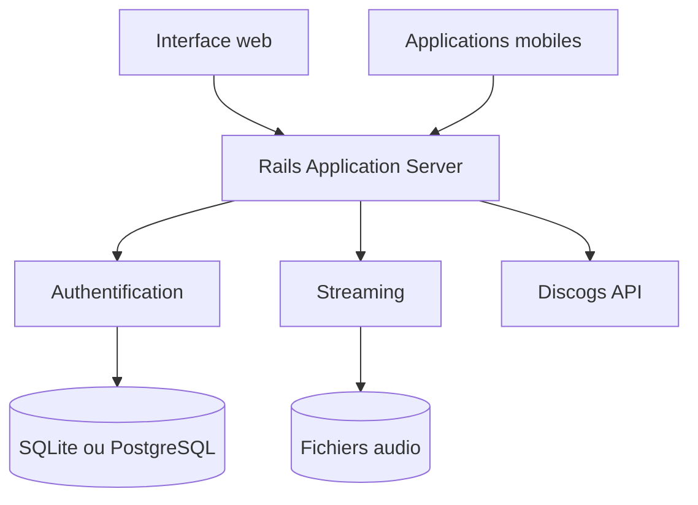

# blackcandy-org/blackcandy

> Self-hosted music streaming server, to listen to your own library from the web and mobile.

## The problem
Listening to your local music collection remotely requires a simple-to-install personal server.

## What it actually does
Rails application shipped as a Docker image. It indexes a folder of audio files (`MEDIA_PATH`), manages users and playlists, search and streaming, with a web app, mobile apps and a SQLite database by default or PostgreSQL. Artist images come from the Discogs API (optional token).

## How it is wired


## Trying it
```shell
docker run -p 80:80 ghcr.io/blackcandy-org/blackcandy:latest
docker run -v /media_data:/media_data -e MEDIA_PATH=/media_data ghcr.io/blackcandy-org/blackcandy:latest
docker run -e SECRET_KEY_BASE=your_generated_secret ghcr.io/blackcandy-org/blackcandy:latest
```

## Cost and gotchas
Free. The initial administrator has a well-known default password (`foobar`): change it. Without a fixed `SECRET_KEY_BASE`, sessions are invalidated at every restart. Read the upgrade guide before changing versions.

## What it is not
Not a public streaming service nor a general-purpose media management tool: it only plays your local music library.

## Alternatives
No alternative named in the README.

## For you
Ignore for your data / AI watch: a good personal music server, unrelated to your line of work.
