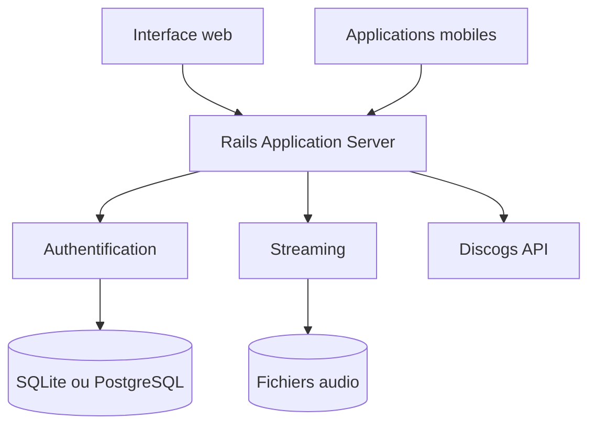

# blackcandy-org/blackcandy

> Serveur de streaming musical auto-hébergé, pour écouter sa propre bibliothèque depuis le web et le mobile.

## Le problème
Écouter sa collection musicale locale à distance demande un serveur personnel simple à installer.

## Ce que ça fait vraiment
Application Rails livrée en image Docker. Elle indexe un dossier de fichiers audio (`MEDIA_PATH`), gère utilisateurs et listes de lecture, recherche et streaming, avec une application web, des applications mobiles et une base SQLite par défaut ou PostgreSQL. Les images d'artistes viennent de l'API Discogs (jeton optionnel).

## Comment c'est branché


## Essayer
```shell
docker run -p 80:80 ghcr.io/blackcandy-org/blackcandy:latest
docker run -v /media_data:/media_data -e MEDIA_PATH=/media_data ghcr.io/blackcandy-org/blackcandy:latest
docker run -e SECRET_KEY_BASE=your_generated_secret ghcr.io/blackcandy-org/blackcandy:latest
```

## Coût et pièges
Gratuit. L'administrateur initial a un mot de passe par défaut connu (`foobar`) : à changer. Sans `SECRET_KEY_BASE` fixe, les sessions sont invalidées à chaque redémarrage. Lire le guide de mise à jour avant de changer de version.

## Ce que ce n'est pas
Ce n'est pas un service de streaming public ni un outil de gestion de médias polyvalent : il ne lit que ta bibliothèque musicale locale.

## Alternatives
Aucune alternative nommée dans le README.

## Pour toi
Ignorer pour ta veille data / IA : bon serveur musical personnel, sans lien avec ton métier.

