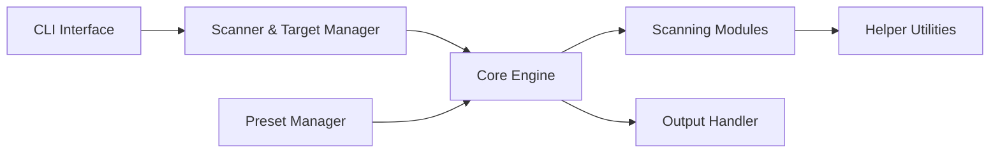

# blacklanternsecurity/bbot

> Modular reconnaissance scanner for mapping a domain's exposure surface, aimed at security teams.

## The problem
Inventorying an organization's exposed subdomains, e-mails and services requires chaining several tools.

## What it actually does
An event engine runs modules (DNS, web, e-mails, cloud, code) chosen through YAML presets (`subdomain-enum`, `spider`, `web`, `kitchen-sink`…). Targets can be domains, IPs, ranges, URLs, organizations. Results go to output modules (CSV, JSON, Neo4j, Postgres, Slack…). Can also be used as a Python library, synchronous or asynchronous.

## How it is wired


## Trying it
```bash
pipx install bbot
bbot -t evilcorp.com -p subdomain-enum
bbot -t evilcorp.com -p subdomain-enum -rf passive
```

## Cost and gotchas
Free; third-party API keys (SecurityTrails, VirusTotal…) enrich the results, to be placed in `~/.config/bbot/secrets.yml`. Version 3.0 breaks compatibility with 2.x.

## What it is not
A dual-use tool: the "web-heavy" and "kitchen-sink" presets are active and noisy. To be run only on targets you own or for which you have a mandate (bug bounty programs included). AGPL-3.0 license: sharing obligations if exposed as a service.

## Alternatives
- Spiderfoot: the tool BBOT draws its inspiration from.
- Amass: also handles third-party API keys.
- Subfinder: same, focused on subdomains.

## For you
Worth watching: useful for inventorying your own cloud/API perimeter, but the AGPL and the offensive nature restrict it to an explicit security framework.
