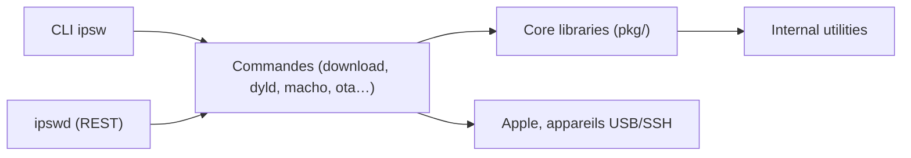

# blacktop/ipsw

> Command-line toolbox for analyzing iOS/macOS firmware, for security researchers.

## The problem
Downloading, extracting and analyzing Apple firmware (IPSW, OTA, dyld_shared_cache, kernel) requires a scattered toolchain.

## What it actually does
`ipsw` CLI (and `ipswd` REST daemon): firmware download, Mach-O analysis and ARM disassembly, dyld_shared_cache, kernel, IMG4/iBoot/SEP, device management (`idev`), App Store Connect API, SSH/Frida. LLM-assisted decompilation (Claude, OpenAI, Gemini, Ollama) as an option.

## How it is wired


## Trying it
```bash
brew install blacktop/tap/ipsw
ipsw download ipsw --device iPhone16,1 --latest
ipsw extract --kernel iPhone16,1_18.2_22C150_Restore.ipsw
ipsw dyld info /path/to/dyld_shared_cache_arm64
```

## Cost and gotchas
Free; LLM API keys at your expense for decompilation, and samples may be sent to those services. Some operations are memory-hungry.

## What it is not
An offensive research and reverse-engineering tool: reserved for an authorized setting. Exhaustive tests are only "planned".

## Alternatives
- No alternative cited in the README.

## For you
Ignore: a mobile security tool, outside the data/AI/MLOps profile.
