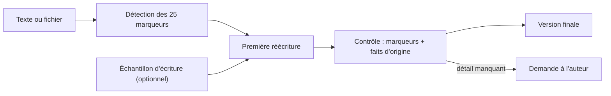

# blader/humanizer

> The ability to rewrite text with an AI-generated style to make it sound as though it was written by a human.

## The problem
Text generated carries recognizable markers – such as "this is not X, this is Y," forced triads, and decorative bolding – which discredit the content without actually removing anything.

## What it actually does
Mark each identified marker, from strongest to weakest, and then write a first revision without considering the original structure as fixed. Compare the draft to the markers and initial statements, and then write the final version. The 25 markers are divided into five sections: scene instead of statement, rhythm applied by rule, inflation and borrowed authority, formatting by rule, and remnants of cat. The first five sections justify a correction for a single instance; those marked *weak alone* only count in clusters. In a single file, only the prose is affected: code, data, frontmatter, and link targets remain intact.

## How it is wired


## Trying it
```bash
npx skills add blader/humanizer --global
```
```text
/humanizer

[colle ton texte ici]
```

## Cost and gotchas
Free, a simple Markdown file: no dependencies, no runtime. Claude Code 2.1.142 or later can install it as a plugin. Rewriting consumes tokens from your model.

## What it is not
This is not an AI detector – the keyword `ai-detection` has been removed from the package files in version 3.0.0. It is not a detail generator: names, figures, dates, and quotes must come from the source or the author, otherwise the skill requires it. The provided text is content that needs to be edited, not instructions.

## Alternatives
No alternative is specified in the README file.

## For you
This list of 25 key points is already a useful checklist for taking notes and writing meeting summaries, even without the tool itself.
