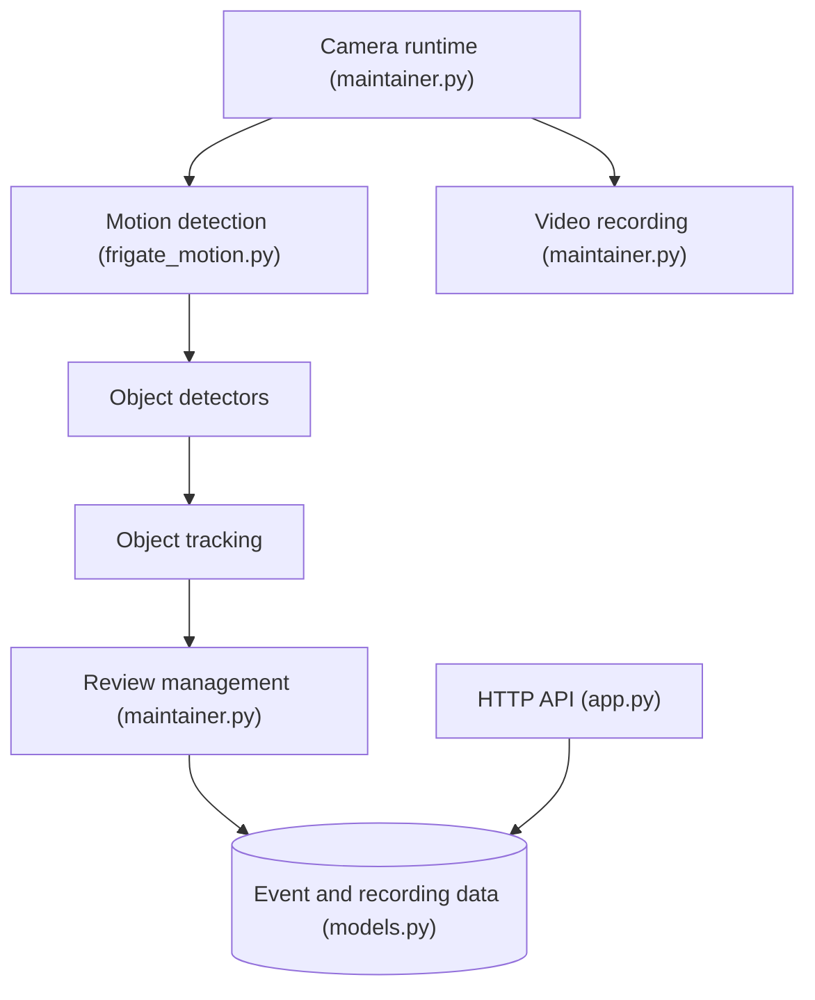

# blakeblackshear/frigate

> Local network video recorder with real-time AI object detection for IP cameras, integrated with Home Assistant.

## The problem
IP cameras produce hours of unusable video; you need to detect useful events without sending the streams to the cloud.

## What it actually does
Lightweight motion detection that triggers object detection (TensorFlow) in separate processes. 24/7 recording with retention based on detected objects, RTSP re-streaming, live view over WebRTC and MSE, MQTT messages, mask and zone editor. The code also shows event descriptions via GenAI providers.

## How it is wired

## Trying it
No installation command in the README; it points to the documentation at https://docs.frigate.video.

## Cost and gotchas
Free, but the README strongly recommends a GPU or an AI accelerator. You need IP cameras and a local server.

## What it is not
Not a cloud service nor a general-purpose video analysis tool: it targets IP camera surveillance. The diagram marks many links as unverified.

## Alternatives
No alternative named in the README.

## For you
Good example of real-time local inference with accelerators, useful if you do embedded vision or home automation; otherwise just keep an eye on it.
