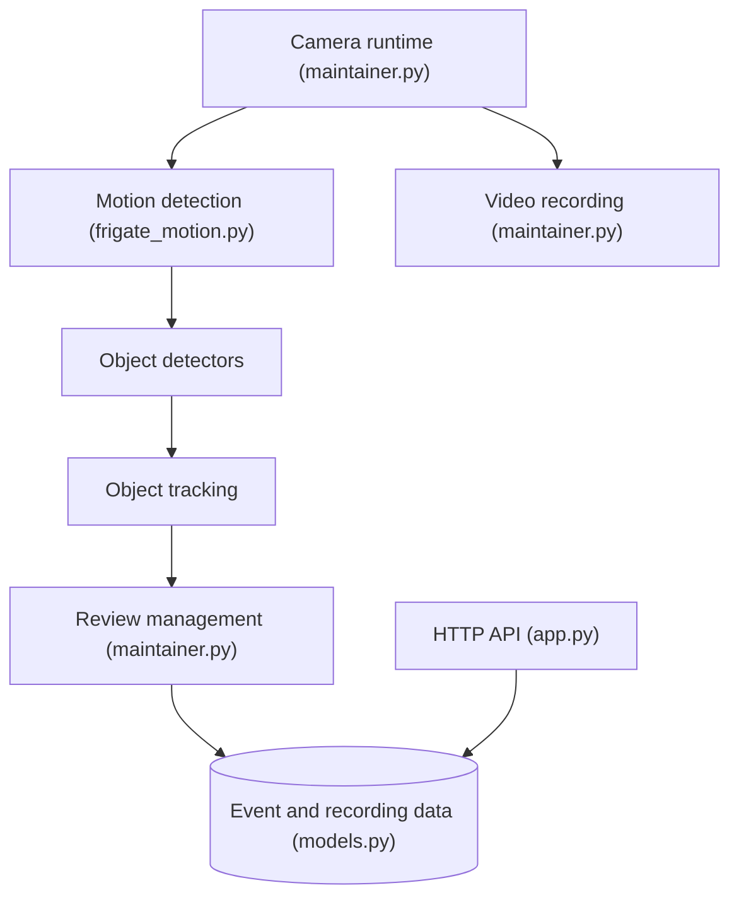

# blakeblackshear/frigate

> Enregistreur vidéo réseau local avec détection d'objets par IA en temps réel pour caméras IP, intégré à Home Assistant.

## Le problème
Les caméras IP produisent des heures de vidéo inexploitable ; il faut détecter les événements utiles sans envoyer les flux dans le cloud.

## Ce que ça fait vraiment
Détection de mouvement légère qui déclenche la détection d'objets (TensorFlow) dans des processus séparés. Enregistrement 24/7 avec rétention selon les objets détectés, re-streaming RTSP, vue en direct WebRTC et MSE, messages MQTT, éditeur de masques et zones. Le code montre aussi des descriptions d'événements via des fournisseurs GenAI.

## Comment c'est branché

## Essayer
Aucune commande d'installation dans le README ; il renvoie à la documentation sur https://docs.frigate.video.

## Coût et pièges
Gratuit, mais le README recommande fortement un GPU ou un accélérateur d'IA. Il faut des caméras IP et un serveur local.

## Ce que ce n'est pas
Pas un service cloud ni un outil d'analyse vidéo généraliste : il vise la surveillance par caméras IP. Le diagramme marque de nombreux liens comme non vérifiés.

## Alternatives
Aucune alternative nommée dans le README.

## Pour toi
Bon exemple d'inférence temps réel en local avec accélérateurs, utile si tu fais de la vision embarquée ou de la domotique ; sinon à surveiller seulement.

