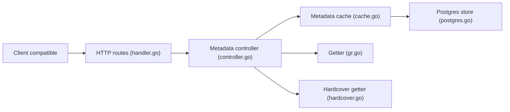

# blampe/rreading-glasses

> Book metadata API cache, compatible with Readarr-type library management clients.

## The problem
The original project was retired and its official metadata service was incomplete and six months behind; community forks need a replacement source.

## What it actually does
Go server that exposes an API compatible with the client and fetches metadata from two sources, a social reading service (names masked in the README) or Hardcover. It caches responses in Postgres, used as a simple key-value store, and loads large authors in the background. It limits returned editions to 20 and strips subtitles except for series cases.

## How it is wired


## Trying it
```bash
docker pull blampe/rreading-glasses:latest
docker pull blampe/rreading-glasses:hardcover
```
Then run with Postgres via `docker-compose-gr.yml` or `docker-compose-hardcover.yml`.

## Cost and gotchas
Postgres required. For Hardcover, you need an account and a token (`--hardcover-auth`) that expires every January 1st. The container uses all available memory for its cache: set `--memory`.

## What it is not
Not a library client, only its metadata provider. Metadata is not editable on the Goodreads-like source side; the Hardcover variant requires a fresh installation.

## Alternatives
pennydreadful/bookshelf and Faustvii/Readarr: community forks already configured to use this service.

## For you
Ignore: personal library management use case, unrelated to data/AI/MLOps, on an ecosystem whose original project is retired.
