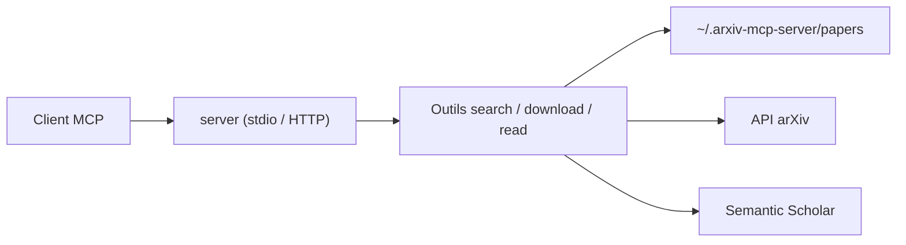

# blazickjp/arxiv-mcp-server

> Local MCP server to search, read by section and cite arXiv papers from an agent.

## The problem
An agent that reads a whole PDF floods its context; it needs an outline, one section at a time, and exact citations.

## What it actually does
19 tools: arXiv search, download to local Markdown, outline and section-by-section reading (Markdown or original LaTeX), passage search, citation graph (Semantic Scholar), BibTeX export, topic watches stored on disk, and optional semantic search (`[pro]`). Reads are capped at 12,000 characters by default. Seven workflow prompts. stdio transport, or HTTP. The architecture diagram is unreadable: this section follows the README.

## How it is wired


## Trying it
```bash
uvx arxiv-mcp-server
claude mcp add --transport stdio --scope user arxiv -- uvx arxiv-mcp-server
uv tool install "arxiv-mcp-server[pdf]"
```

## Cost and gotchas
Free; a Semantic Scholar key is optional to avoid rate limits. arXiv imposes ~3 s between requests. Paper text is untrusted content (prompt injection risk, says the README). Do not install it via npm: an unrelated package with the same name exists.

## What it is not
Not a semantic search engine by default (`[pro]` extra with local embeddings). Not a library manager like Zotero.

## Alternatives
Not documented in the README.

## For you
Adopt: one-line installation, bounded reading that saves context, and a core use case for an AI profile's paper watch.
