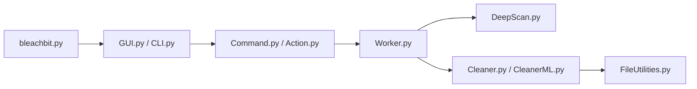

# bleachbit/bleachbit

> File cleaner that frees disk space and protects privacy, with a graphical interface or command line.

## The problem
Caches, histories and temporary files pile up and leave traces.

## What it actually does
"Cleaners" described in XML (CleanerML) list what to delete; the GTK interface or the CLI previews, then deletes. Modules for deep scan, overwriting, updating, generation of decoy files (chaff) via markovify, translations through Weblate.

## How it is wired


## Trying it
```bash
make install-deps
make -C po local
python3 bleachbit.py
python3 bleachbit.py --help
```

## Cost and gotchas
Free. System dependencies vary by distribution (Debian, Fedora, openSUSE, Arch). Always use "Preview" before "Delete": deletion is real.

## What it is not
Not a guarantee of forensic erasure: the README does not detail this point. GPL-3.0 license (copyleft).

## Alternatives
No alternative named in the README.

## For you
Ignore: workstation hygiene utility, unrelated to data/AI/MLOps work.
