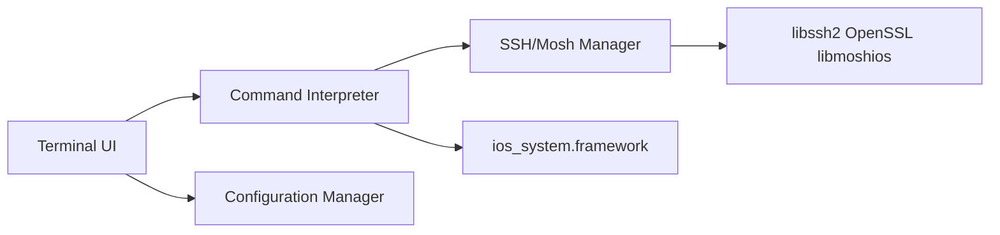

# blinksh/blink

> iOS terminal with Mosh and SSH, for administering servers from an iPhone or iPad.

## The problem
Keeping a stable SSH session from a mobile device whose connection keeps changing.

## What it actually does
Full-screen terminal rendered by Chromium's hterm, Mosh and SSH sessions, configurable keys and hosts, gestures, SplitView. It embeds Unix commands (ls, cp, curl, scp, sftp, tar, python, lua) via `ios_system.framework`, without pipes. The architecture describes interface, command engine, session management and libraries (libssh2, OpenSSL, libmoshios).

## How it is wired


## Trying it
```bash
git clone --recursive https://github.com/blinksh/blink.git && \
    cd blink && ./get_frameworks.sh && ./get_resources.sh && \
    rm -rf Blink.xcodeproj/project.xcworkspace/xcshareddata/
cp template_setup.xcconfig developer_setup.xcconfig
```

## Cost and gotchas
Available on the App Store (pricing terms are not in the README). Building it yourself requires Xcode, an Apple developer ID and a device.

## What it is not
Not a full shell: no pipes, limited commands, writing restricted to `~/Documents` and a few folders by the iOS sandbox. GPL-3.0 license (copyleft).

## Alternatives
No alternative named in the README.

## For you
Worth watching: useful for monitoring a GPU cluster or restarting a job from an iPad via Mosh, but you will only need it if you work from iOS.
