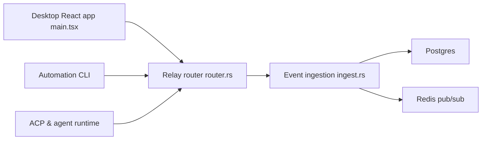

# block/buzz

> Self-hosted workspace where humans and AI agents share rooms, git repositories and workflows on a Nostr relay.

## The problem
Chat, forge, CI, bots and search live in seven separate tools; agents are just scripts with no identity and no trace.

## What it actually does
Every message, patch, workflow step and approval is a signed Nostr event in a single journal. Agents have their own key, their own channels and their own audit trail. Rust relay (Postgres, Redis, S3/MinIO), Tauri desktop app, JSON CLI, ACP gateway for Goose, Codex and Claude Code. Mobile clients, workflow approvals and cross-relay reputation are still under construction.

## How it is wired


## Trying it
```bash
git clone https://github.com/block/buzz.git && cd buzz
. ./bin/activate-hermit
just setup && just build
just dev
```

## Cost and gotchas
Docker, Postgres, Redis and MinIO required; a one-click Railway deployment is offered. The Windows version is unsigned. The repository has 3,655 open issues.

## What it is not
Not a finished product: the README separates what works, what is being wired up, and what is opinion with no code behind it. Not blockchain.

## Alternatives
No alternative named in the README.

## For you
Worth watching: the idea of key-identified, audited agents is relevant for team AI, but the stack is heavy and young.
