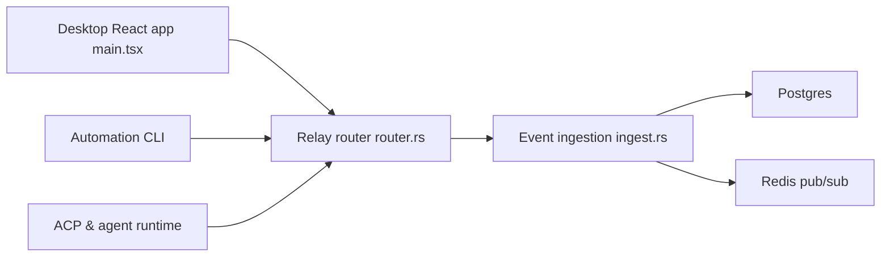

# block/buzz

> Espace de travail auto-hébergé où humains et agents IA partagent salons, dépôts git et workflows sur un relais Nostr.

## Le problème
Chat, forge, CI, bots et recherche vivent dans sept outils séparés ; les agents y sont des scripts sans identité ni trace.

## Ce que ça fait vraiment
Chaque message, patch, étape de workflow et approbation est un événement Nostr signé dans un seul journal. Les agents ont leur propre clé, leurs canaux et leur piste d'audit. Relais Rust (Postgres, Redis, S3/MinIO), application de bureau Tauri, CLI JSON, passerelle ACP pour Goose, Codex et Claude Code. Les clients mobiles, les approbations de workflow et la réputation entre relais sont encore en chantier.

## Comment c'est branché


## Essayer
```bash
git clone https://github.com/block/buzz.git && cd buzz
. ./bin/activate-hermit
just setup && just build
just dev
```

## Coût et pièges
Docker, Postgres, Redis et MinIO requis ; un déploiement Railway en un clic est proposé. Version Windows non signée. Le dépôt compte 3 655 issues ouvertes.

## Ce que ce n'est pas
Pas un produit fini : le README sépare ce qui marche, ce qui est en câblage et ce qui est de l'opinion sans code. Pas de la blockchain.

## Alternatives
Aucune alternative nommée dans le README.

## Pour toi
À surveiller : l'idée d'agents identifiés par clé et audités est pertinente pour l'IA en équipe, mais la pile est lourde et jeune.

