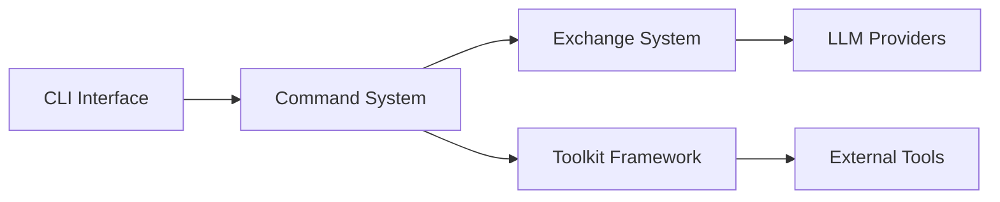

# block/goose

> Open-source local AI agent (app, CLI, API) for general code and tasks, connected to 15+ LLM providers.

## The problem
AI assistants housed within an editor or SaaS platform do not uniformly control your machine or tools.

## What it actually does
Operates locally, on desktop apps, via CLI or API. Interacts with more than 15 providers (Anthropic, OpenAI, Google, Ollama, OpenRouter, Azure, Bedrock) and over 70 extensions through MCP. Written in Rust. Owned by the Agentic AI Foundation (Linux Foundation). This repository is the same project as aaif-goose/goose (same creation date, same issues).

## How it is wired
The diagram provided describes an older version of Python (src/goose/cli, toolkit, exchange) which no longer corresponds to the current README in Rust.


## Trying it
```bash
curl -fsSL https://github.com/aaif-goose/goose/releases/download/stable/download_cli.sh | bash
```

## Cost and gotchas
Free, but LLM calls are at your own expense (API keys or Claude/ChatGPT/Gemini subscriptions via ACP). The diagram is outdated compared to the README.

## What it is not
Not a hosted service. Not the latest version of the diagram: low architectural reliability. Possible duplication of aaif-goose/goose.

## Alternatives
No alternative is specified in the README.

## For you
It should be monitored under its current name, aaif-goose/goose: a useful MCP agent for automation, but this repository is a duplicate and should not be followed twice.
