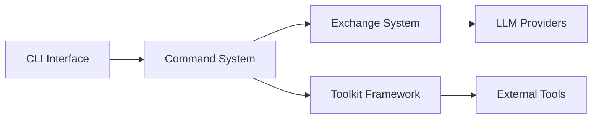

# block/goose

> Agent IA local open source (app, CLI, API) pour le code et les tâches générales, branché sur 15+ fournisseurs de LLM.

## Le problème
Les assistants IA enfermés dans un éditeur ou un SaaS ne pilotent pas ta machine ni tes outils de façon uniforme.

## Ce que ça fait vraiment
Tourne en local, en app desktop, CLI ou API. Parle à plus de 15 fournisseurs (Anthropic, OpenAI, Google, Ollama, OpenRouter, Azure, Bedrock) et à 70+ extensions via MCP. Écrit en Rust. Appartient à l'Agentic AI Foundation (Linux Foundation). Ce dépôt est le même projet que aaif-goose/goose (même date de création, mêmes issues).

## Comment c'est branché
Le diagramme fourni décrit une ancienne version Python (src/goose/cli, toolkit, exchange) qui ne correspond plus au README actuel en Rust.


## Essayer
```bash
curl -fsSL https://github.com/aaif-goose/goose/releases/download/stable/download_cli.sh | bash
```

## Coût et pièges
Gratuit, mais les appels LLM sont à ta charge (clés d'API ou abonnements Claude/ChatGPT/Gemini via ACP). Le diagramme est périmé par rapport au README.

## Ce que ce n'est pas
Pas un service hébergé. Pas la version à jour du diagramme : fiabilité d'architecture faible. Doublon probable de aaif-goose/goose.

## Alternatives
Aucune alternative nommée dans le README.

## Pour toi
À surveiller sous son nom actuel aaif-goose/goose : agent MCP utile pour l'automatisation, mais ce dépôt est un doublon à ne pas suivre deux fois.

