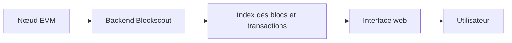

# blockscout/blockscout

> Open-source block explorer for EVM chains (Ethereum, L2s, testnets), for whoever operates a network.

## The problem
Inspecting transactions and contracts on a private network or an L2 without depending on a closed explorer like Etherscan.

## What it is not
Not a wallet or a node: it is a blockchain explorer that reads the data of an existing node.

## What it actually does
Lets you search transactions, accounts and balances, verify and interact with contracts, and browse on-chain applications. Targets Ethereum Mainnet, Classic, Optimism, Gnosis and their forks. Architecture details are not documented in this README.

## How it is wired

## Trying it
No documented command. The README points to the documentation: manual deployment, Docker Compose, Kubernetes or Ansible.

## Cost and gotchas
Infrastructure to self-host (node + database). The very short README gives no resource figures. A license exists but is not identified by GitHub.

## Alternatives
- Etherscan, Etherchain: cited as closed explorers that Blockscout replaces.

## For you
Ignore: a blockchain explorer with no link to data/AI, except for on-chain analysis.
