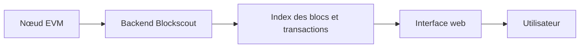

# blockscout/blockscout

> Explorateur de blocs open source pour chaînes EVM (Ethereum, L2, testnets), pour qui opère un réseau.

## Le problème
Inspecter transactions et contrats sur un réseau privé ou un L2 sans dépendre d'un explorateur fermé comme Etherscan.

## Ce que ce n'est pas
Pas un portefeuille ni un nœud : c'est un explorateur de blockchain qui lit les données d'un nœud existant.

## Ce que ça fait vraiment
Permet de chercher transactions, comptes et soldes, de vérifier et d'interagir avec des contrats, et de consulter les applications sur la chaîne. Cible Ethereum Mainnet, Classic, Optimism, Gnosis et leurs forks. Les détails d'architecture ne sont pas documentés dans ce README.

## Comment c'est branché

## Essayer
Aucune commande documentée. Le README renvoie à la documentation : déploiement manuel, Docker Compose, Kubernetes ou Ansible.

## Coût et pièges
Infrastructure à héberger soi-même (nœud + base). Le README, très court, ne chiffre pas les ressources. La licence existe mais n'est pas identifiée par GitHub.

## Alternatives
- Etherscan, Etherchain : cités comme explorateurs fermés que Blockscout remplace.

## Pour toi
À ignorer : explorateur blockchain sans lien avec data/IA, sauf analyse on-chain.

