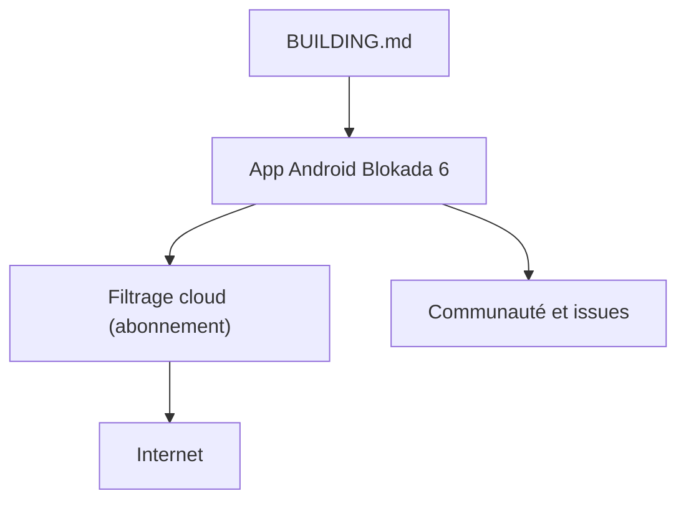

# blokadaorg/blokada

> Ad and tracker blocker for Android, whose version 6 requires a subscription.

## The problem
Mobile ads and trackers weigh on privacy and comfort.

## What it actually does
Blokada 6 filters in the cloud (the subscription funds the service), unlike Blokada 5, which blocks on the device, for free. The repository contains the Android app code; the README points to a community, a tracker and BUILDING.md.

## How it is wired
Simplified diagram based on the sheet, no diagram provided.

## Trying it
No command in the README: install via Google Play, build per BUILDING.md.

## Cost and gotchas
Subscription required for version 6; filtering goes through a third-party service. Fake sites imitate the product: only blokada.org is official.

## What it is not
Not free in version 6 and not local filtering: Blokada 5 is.

## Alternatives
- Blokada 5: on-device blocking, free.

## For you
Ignore: a consumer mobile tool, unrelated to your field.
