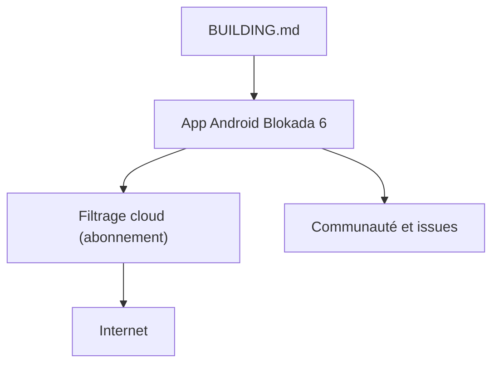

# blokadaorg/blokada

> Bloqueur de publicités et de traqueurs pour Android, dont la version 6 exige un abonnement.

## Le problème
Les pubs et traqueurs mobiles pèsent sur la vie privée et le confort.

## Ce que ça fait vraiment
Blokada 6 filtre côté cloud (l'abonnement finance le service), contrairement à Blokada 5 qui bloque sur l'appareil, gratuit. Le dépôt contient le code de l'app Android ; le README renvoie à une communauté, un tracker et BUILDING.md.

## Comment c'est branché
Schéma simplifié d'après la fiche, sans diagramme fourni.

## Essayer
Aucune commande dans le README : installation via Google Play, build selon BUILDING.md.

## Coût et pièges
Abonnement requis pour la version 6 ; le filtrage passe par un service tiers. Des faux sites imitent le produit : seul blokada.org est officiel.

## Ce que ce n'est pas
Pas gratuit en version 6 et pas un filtrage local : c'est Blokada 5 qui l'est.

## Alternatives
- Blokada 5 : blocage sur l'appareil, gratuit.

## Pour toi
Ignorer : outil grand public pour mobile, sans rapport avec ton métier.

