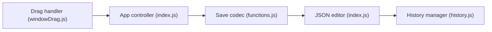

# bloodorca/hollow

> Online editor for Hollow Knight save files, for players.

## The problem
The game's save files are encrypted and cannot be edited by hand.

## What it actually does
A web page that decrypts a `user1.dat` file, displays the JSON, lets you edit it, then download a new encrypted file. According to the code, a Switch mode (plain text) and a local history in the browser also exist. The method is taken from the Hollow Knight Save Manager by @KayDeeTee.

## How it is wired


## Trying it
```bash
# Aucune commande dans le README : ouvrir https://bloodorca.github.io/hollow/ et suivre les étapes.
```

## Cost and gotchas
Free. Back up the file before any edit. License: none. Last push in 2019.

## What it is not
Not an online cheating tool: everything happens on a local file. Not maintained since 2019.

## Alternatives
Hollow Knight Save Manager (@KayDeeTee), the source of the method.

## For you
Ignore: a gaming tool unrelated to your work, abandoned since 2019.
