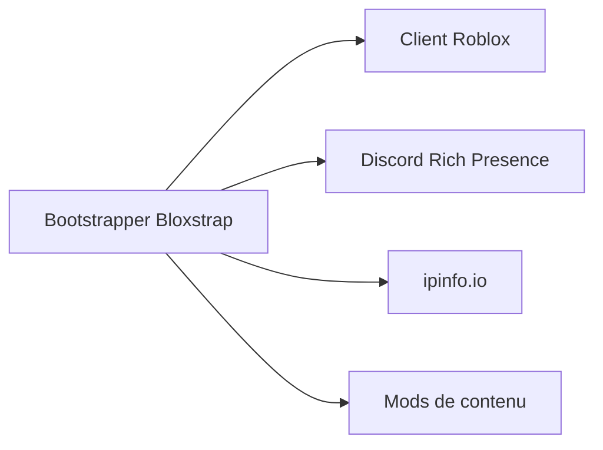

# bloxstraplabs/bloxstrap

> Third-party replacement for the Roblox launcher on Windows, with Discord presence and graphics options.

## The problem
The standard Roblox launcher offers few settings and little customization.

## What it actually does
Replaces the Roblox bootstrapper: Discord Rich Presence, modification of content files (death sound, cursor), server geolocation via ipinfo.io, graphics and interface settings. Windows only, requires the .NET 6 Desktop runtime. The README states that it is no longer under active development.

## How it is wired


## Trying it
```bash
winget install bloxstrap
```

## Cost and gotchas
Free. SmartScreen may raise a warning. Calls ipinfo.io. The only official sources are the repository and bloxstraplabs.com. 1,428 open issues, slow replies.

## What it is not
Not a cheat: the README claims it does not interact with the client like an exploit, with no guarantee against a Roblox ban.

## Alternatives
No alternative named in the README.

## For you
Ignore: a Windows gaming utility with no link to your work, and no longer actively developed.
