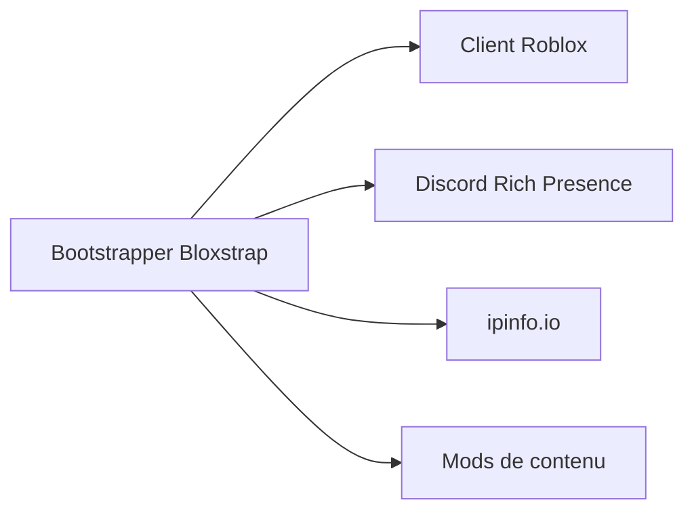

# bloxstraplabs/bloxstrap

> Remplaçant tiers du lanceur Roblox sous Windows, avec présence Discord et options graphiques.

## Le problème
Le lanceur Roblox standard offre peu de réglages et de personnalisation.

## Ce que ça fait vraiment
Remplace le bootstrapper Roblox : Discord Rich Presence, modification des fichiers de contenu (son de mort, curseur), géolocalisation du serveur via ipinfo.io, réglages graphiques et d'interface. Windows uniquement, nécessite le runtime .NET 6 Desktop. Le README annonce qu'il n'est plus en développement actif.

## Comment c'est branché


## Essayer
```bash
winget install bloxstrap
```

## Coût et pièges
Gratuit. SmartScreen peut alerter. Appelle ipinfo.io. Seuls sources officielles : le dépôt et bloxstraplabs.com. 1 428 issues ouvertes, réponses lentes.

## Ce que ce n'est pas
Pas un cheat : le README affirme qu'il n'interagit pas avec le client comme un exploit, sans garantie contre un bannissement par Roblox.

## Alternatives
Aucune alternative nommée dans le README.

## Pour toi
À ignorer : utilitaire de jeu Windows sans lien avec ton métier, et plus développé activement.

