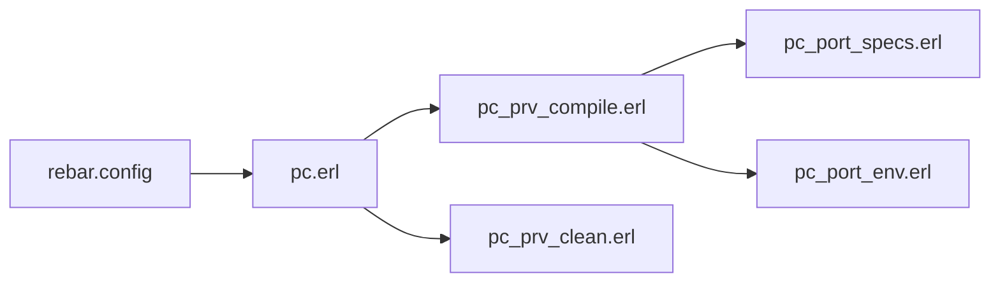

# blt/port_compiler

> rebar3 plugin to compile native code (NIFs, ports) while keeping the rebar2 configuration.

## The problem
Erlang projects with C/C++ code depended on rebar2's port compiler, which is absent from rebar3.

## What it actually does
Provides `rebar3 pc compile` and `pc clean`, hookable via `provider_hooks`. Reads `port_specs` and `port_env` (CC, CFLAGS, LDFLAGS, templates). The `pc_clang_db` option is for clang-tidy. `overrides` lets it be applied to a dependency such as jiffy. README truncated at the end of the configuration block.

## How it is wired


## Trying it
```bash
rebar3 pc compile
```
With `{plugins, [pc]}.` in `rebar.config`.

## Cost and gotchas
A C/C++ toolchain is required. Not a strict command-line replacement. The `${}` syntax must be used.

## What it is not
Not a strict replacement for rebar2's port compiler on the command line: the syntax must be adapted (`${}`). Not a C/C++ compiler: it calls the installed C/C++ toolchain.

## Alternatives
No alternative named in the README.

## For you
Ignore: useful only if you compile Erlang NIFs.
