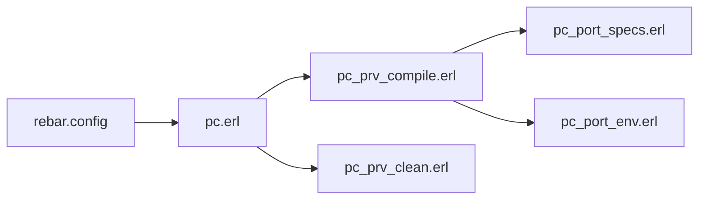

# blt/port_compiler

> Plugin rebar3 pour compiler du code natif (NIF, ports) en conservant la configuration rebar2.

## Le problème
Les projets Erlang avec code C/C++ dépendaient du port compiler de rebar2, absent de rebar3.

## Ce que ça fait vraiment
Fournit `rebar3 pc compile` et `pc clean`, accrochables via `provider_hooks`. Lit `port_specs` et `port_env` (CC, CFLAGS, LDFLAGS, gabarits). Option `pc_clang_db` pour clang-tidy. `overrides` permet de l'appliquer à une dépendance comme jiffy. README tronqué en fin de bloc de configuration.

## Comment c'est branché


## Essayer
```bash
rebar3 pc compile
```
Avec `{plugins, [pc]}.` dans `rebar.config`.

## Coût et pièges
Chaîne C/C++ requise. Pas un remplacement strict en ligne de commande. Il faut utiliser la syntaxe `${}`.

## Ce que ce n'est pas
Pas un remplacement strict du port compiler de rebar2 en ligne de commande : il faut adapter la syntaxe (`${}`). Pas un compilateur C/C++ : il appelle la chaîne C/C++ installée.

## Alternatives
Aucune alternative nommée dans le README.

## Pour toi
À ignorer : utile seulement si tu compiles des NIF Erlang.

