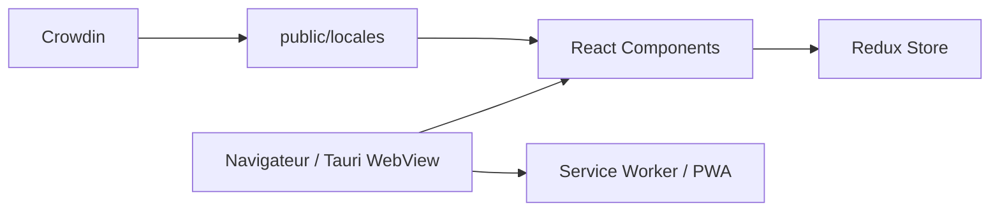

# blueedgetechno/win11React

> Replica of the Windows 11 desktop in the browser, built with React, for demonstration or curiosity.

## The problem
No business need: the author wants to reproduce the Windows 11 desktop experience with standard web technologies.

## What it actually does
React (17) and Redux single-page application, with no UI library, styled with SCSS and Tailwind. Reproduces the Start menu, widgets, resizable windows, calculator, notepad, file explorer, lock screen, themes, multilingual support. Works as a PWA and can be packaged as a desktop application via Tauri. No backend.

## How it is wired


## Trying it
```bash
docker run -d --restart unless-stopped --name win11react -p 3000:3000 blueedge/win11react:latest
winget install blueedge.win11react
```

## Cost and gotchas
Free. Repository archived, last push in August 2024. Blur does not work in Firefox without an `about:config` tweak.

## What it is not
It is not an operating system nor a cloud PC, and the project is not affiliated with Microsoft in any way.

## Alternatives
No alternative named in the README.

## For you
Ignore: a frozen, archived demo project, of no use for a data, AI or MLOps workflow.
