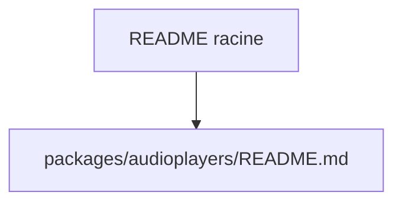

# bluefireteam/audioplayers

> Repo named audioplayers; the README provided contains only a path, with no description.

## The problem
Not documented: the README provided is limited to `packages/audioplayers/README.md`.

## What it actually does
Not documented. The name suggests an audio player, but nothing in the material provided confirms it. The catalog lists an MIT license, 2,145 stars, a repo created in 2017 and a last push on 2026-11-06.

## How it is wired
Simplified diagram based on the sheet, no diagram provided.

## Trying it
No command documented in the material provided.

## Cost and gotchas
Not documented. The real cost is unknown for lack of a usable README.

## What it is not
Impossible to say what it is not: the sheet remains minimal. Do not infer a use from the repo name alone.

## Alternatives
No alternative named in the README.

## For you
Keep an eye on it: notable recent activity and popularity, but you need to read `packages/audioplayers/README.md` before judging its interest for a data / AI profile.
