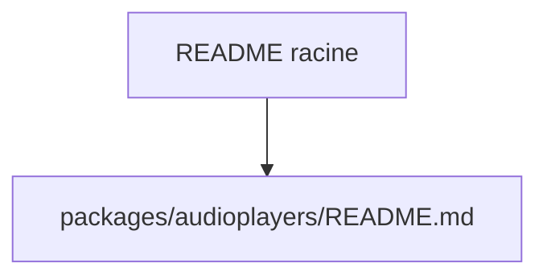

# bluefireteam/audioplayers

> Dépôt nommé audioplayers ; le README fourni ne contient qu'un chemin, sans description.

## Le problème
Non documenté : le README fourni se limite à `packages/audioplayers/README.md`.

## Ce que ça fait vraiment
Non documenté. Le nom suggère un lecteur audio, mais rien dans la matière fournie ne le confirme. Le catalogue indique une licence MIT, 2 145 étoiles, un dépôt créé en 2017 et un dernier push le 2026-11-06.

## Comment c'est branché
Schéma simplifié d'après la fiche, sans diagramme fourni.

## Essayer
Aucune commande documentée dans la matière fournie.

## Coût et pièges
Non documenté. Le coût réel est inconnu faute de README exploitable.

## Ce que ce n'est pas
Impossible de dire ce que ce n'est pas : la fiche reste minimale. Ne pas déduire d'usage à partir du seul nom du dépôt.

## Alternatives
Aucune alternative nommée dans le README.

## Pour toi
À surveiller : activité récente et popularité notables, mais il faut lire `packages/audioplayers/README.md` avant de juger de l'intérêt pour un profil data / IA.

