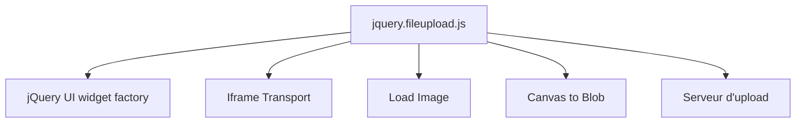

# blueimp/jQuery-File-Upload

> Widget jQuery d'envoi de fichiers : glisser-déposer, barres de progression, envoi par morceaux et reprise.

## Le problème
Envoyer de gros fichiers depuis un navigateur avec progression, validation et prévisualisation.

## Ce que ça fait vraiment
Plugin jQuery qui gère sélection multiple, glisser-déposer, annulation, reprise, découpage en chunks, redimensionnement d'images côté client et aperçus audio, vidéo, image. Compatible avec tout serveur qui accepte un formulaire d'upload standard. Retombe sur des iframes pour les vieux navigateurs.

## Comment c'est branché


## Essayer
```sh
npm install blueimp-file-upload
```
```js
$('#fileupload').fileupload();
```

## Coût et pièges
Gratuit. Exige jQuery 1.7+ et un côté serveur sécurisé : le README renvoie aux documents VULNERABILITIES et SECURITY.

## Ce que ce n'est pas
Ce n'est pas un composant serveur ni une solution moderne sans jQuery. Dépôt archivé.

## Alternatives
Aucune alternative nommée dans le README.

## Pour toi
À ignorer : dépendance jQuery et dépôt archivé, hors de ton travail data et IA.

