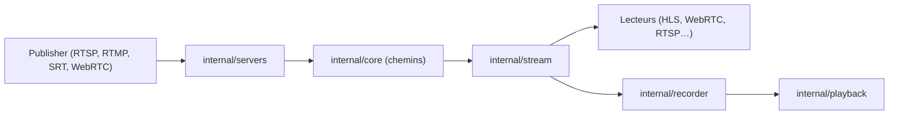

# bluenviron/mediamtx

> Dependency-free media server that receives, converts, records and relays real-time video and audio streams.

## The problem
Moving a stream from a camera or a piece of software to players that speak other protocols requires disparate gateways.

## What it actually does
A single Go executable acting as a media router. It accepts streams in RTSP, RTMP, SRT, WebRTC, HLS, MPEG-TS, RTP, Media-over-QUIC, automatically converts them to other protocols, records them as fMP4 or MPEG-TS and plays them back. It handles authentication (internal, HTTP, JWT), hot configuration reload, a control API, Prometheus metrics and external command hooks. It also offers static sources (including the Raspberry Pi camera).

## How it is wired

## Trying it
No command documented in the README (it points to the installation and documentation pages).

## Cost and gotchas
Free, MIT. Runs on Linux, Windows and macOS, with no dependencies. Docker images exist (standard, Raspberry Pi, FFmpeg). The README details neither default security nor sizing.

## What it is not
Not a video analysis or computer vision tool: it carries the streams, it does not interpret them.

## Alternatives
No alternative cited in the README.

## For you
Worth watching: a plausible building block to feed a vision pipeline (RTSP cameras to an inference service), to test on your case.
