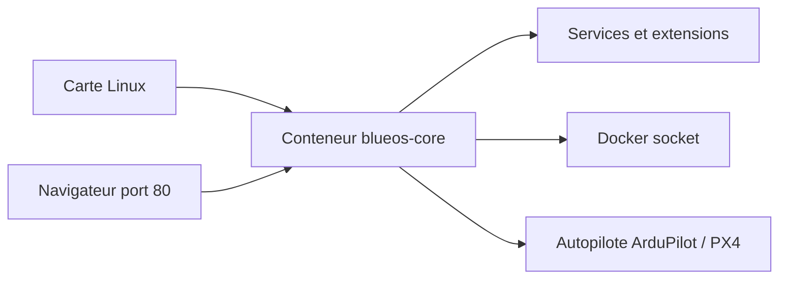

# bluerobotics/BlueOS

> Modular embedded system for piloting a robot, boat or submarine from its onboard computer.

## The problem
Linking the video stream, communications and autopilot of a vehicle without a custom, hard-to-update solution.

## What it actually does
Extensible platform for Raspberry Pi 3/4/5 or another Linux board, compatible with ArduRover, ArduSub, ArduPilot and PX4. Three release channels: stable, beta, master. A web interface handles configuration.

## How it is wired
Simplified diagram based on the sheet, no diagram provided.


## Trying it
```bash
git clone --depth=1 --recurse-submodules --shallow-submodules https://github.com/bluerobotics/blueos
cd core/compose/ && docker compose pull && cd -
docker compose -f core/compose/compose.yml up
```

## Cost and gotchas
Free, but the container is privileged, on the host network, with access to `/dev`, the Docker socket and SSH keys. The example uses the password `raspberry`. License not identified by GitHub.

## What it is not
Not a generic software tool: it requires robotics hardware. The Docker Compose mode is partial (mDNS and wifi missing).

## Alternatives
No alternative named in the README.

## For you
Ignore: specific to underwater and surface robotics, unrelated to data/AI/MLOps.
