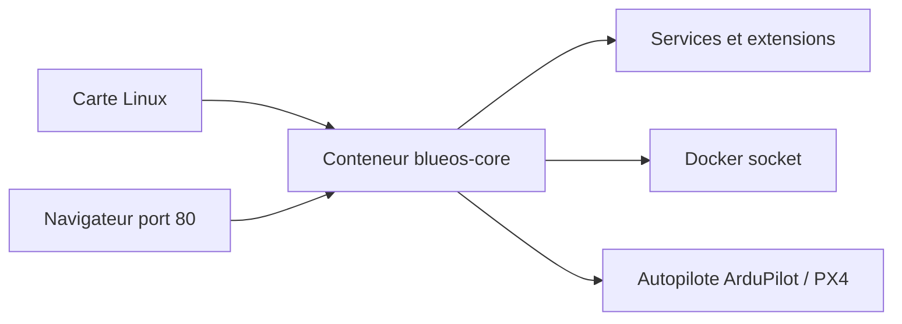

# bluerobotics/BlueOS

> Système embarqué modulaire pour piloter un robot, un bateau ou un sous-marin depuis son ordinateur de bord.

## Le problème
Relier flux vidéo, communications et autopilote d'un véhicule sans solution sur mesure et difficile à mettre à jour.

## Ce que ça fait vraiment
Plateforme à extensions pour Raspberry Pi 3/4/5 ou autre carte Linux, compatible ArduRover, ArduSub, ArduPilot et PX4. Trois canaux de version : stable, beta, master. Une interface web sert la configuration.

## Comment c'est branché
Schéma simplifié d'après la fiche, sans diagramme fourni.


## Essayer
```bash
git clone --depth=1 --recurse-submodules --shallow-submodules https://github.com/bluerobotics/blueos
cd core/compose/ && docker compose pull && cd -
docker compose -f core/compose/compose.yml up
```

## Coût et pièges
Gratuit, mais le conteneur est privilégié, en réseau hôte, avec accès à `/dev`, au socket Docker et aux clés SSH. L'exemple utilise le mot de passe `raspberry`. Licence non identifiée par GitHub.

## Ce que ce n'est pas
Pas un outil logiciel générique : il faut du matériel robotique. Le mode Docker Compose est partiel (mDNS, wifi absents).

## Alternatives
Aucune alternative nommée dans le README.

## Pour toi
À ignorer : spécifique à la robotique sous-marine et de surface, sans rapport avec data/IA/MLOps.

