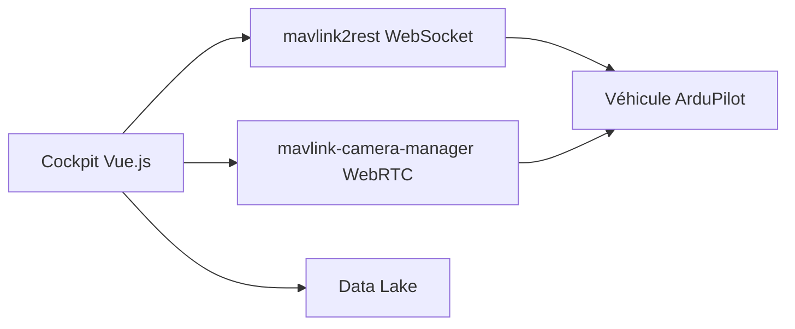

# bluerobotics/cockpit

> Web-based ground control station for remote vehicles (ROVs, boats, drones), for pilots and integrators.

## The problem
Piloting underwater, surface or aerial vehicles requires a single, configurable interface that handles video, telemetry and missions.

## What it actually does
Interface with draggable widgets, with the MAVLink protocol (ArduPilot), gamepads, WebRTC video streams, recording, mission planning with maps, a data lake of variables and custom actions. Available in the browser, as an Electron application or as a BlueOS extension.

## How it is wired

Simplified diagram based on the sheet, no diagram provided.

## Trying it
```bash
docker run -p 8080:8080 bluerobotics/cockpit:latest
git clone --recurse-submodules https://github.com/bluerobotics/cockpit.git
cd cockpit
yarn install
yarn dev
docker-compose -f sim.yml --profile ardusub up
```

## Cost and gotchas
Free. The browser offers fewer features than the desktop application. Video requires `mavlink-camera-manager` outside BlueOS. License present but not identified. 664 open issues.

## What it is not
Not a simulator: simulation goes through an ArduSub Docker Compose. No geofencing in mission planning.

## Alternatives
None named in the README.

## For you
Useful in underwater robotics or drones, not in data or AI; ignore unless you need this domain.
