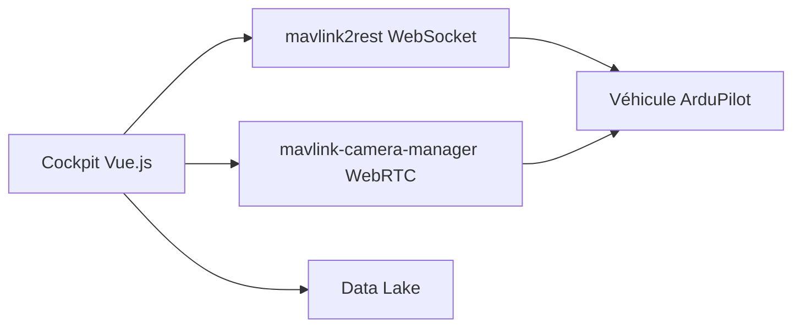

# bluerobotics/cockpit

> Station de contrôle au sol web pour véhicules distants (ROV, bateaux, drones), pour pilotes et intégrateurs.

## Le problème
Piloter des véhicules sous-marins, de surface ou aériens exige une interface unique, configurable, qui gère vidéo, télémétrie et missions.

## Ce que ça fait vraiment
Interface à widgets déplaçables, avec protocole MAVLink (ArduPilot), manettes, flux vidéo WebRTC, enregistrement, planification de mission avec cartes, lac de données de variables et actions personnalisées. Existe en navigateur, en application Electron ou en extension BlueOS.

## Comment c'est branché

Schéma simplifié d'après la fiche, sans diagramme fourni.

## Essayer
```bash
docker run -p 8080:8080 bluerobotics/cockpit:latest
git clone --recurse-submodules https://github.com/bluerobotics/cockpit.git
cd cockpit
yarn install
yarn dev
docker-compose -f sim.yml --profile ardusub up
```

## Coût et pièges
Gratuit. Le navigateur offre moins de fonctions que l'application de bureau. La vidéo exige `mavlink-camera-manager` hors BlueOS. Licence présente mais non identifiée. 664 issues ouvertes.

## Ce que ce n'est pas
Pas un simulateur : la simulation passe par un Docker Compose ArduSub. Pas de geofencing dans la planification de mission.

## Alternatives
Aucune nommée dans le README.

## Pour toi
Utile en robotique sous-marine ou drone, pas en data ou IA ; à ignorer sauf besoin de ce domaine.

