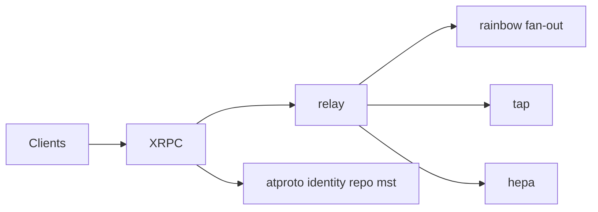

# bluesky-social/indigo

> Go libraries and services for the atproto protocol (Bluesky): relay, sync, moderation.

## The problem
Building a client or a service on the decentralized social network Bluesky requires types, identity resolution and reference services.

## What it actually does
Services: `tap` (sync and catch-up), `relay`, `rainbow` (firehose fan-out), `hepa` (auto-moderation for Ozone). Packages: Lexicon types, HTTP client, OAuth, identity (DID, handle), repository and Merkle tree, crypto.

## How it is wired


## Trying it
```bash
brew install go
go install github.com/bluesky-social/indigo/cmd/tap
tap
make build
make test
go run ./cmd/relay
```

## Cost and gotchas
The README warns that the packages are under active development and may break. The maintainers provide no build support and may ignore issues and PRs. The provided diagram cites BigSky and Palomar, absent from the current list: it seems outdated.

## What it is not
It is not the TypeScript implementation (PDS, AppView), which lives in another repository.

## Alternatives
- bluesky-social/atproto: TypeScript reference implementation (PDS, AppView).

## For you
Ignore: useful only if you build on atproto in Go; no direct value for a data or AI workflow.
