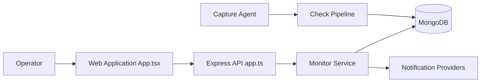

# bluewave-labs/checkmate

> Self-hosted tool for monitoring server uptime, response time and incidents.

## The problem
Knowing when a site, a port or a container goes down, with alerts and a status page, without paying for a monitoring SaaS.

## What it actually does
HTTP monitors (with SSL expiry), ping, port, DNS, Docker, gRPC, WebSocket, JSON query, PageSpeed.
Cycle: check → storage → state-change threshold → incident → notification (email, Slack, PagerDuty, Telegram…).
Status pages, scheduled maintenance; the Capture agent (Go) reports CPU/RAM/disk.
Stack: React + Node.js/Express + MongoDB, all-in-one image and detachable worker (`QUEUE_MODE`).

## How it is wired


## Trying it
```bash
curl -O https://raw.githubusercontent.com/bluewave-labs/checkmate/master/docker/docker-compose.yaml
JWT_SECRET="$(openssl rand -hex 32)" docker compose up -d
```

## Cost and gotchas
Free, AGPL-3.0. MongoDB mandatory; `ENCRYPTION_KEY` required for Docker TLS monitors. The Helm chart still uses the old v3.8.1 images.

## What it is not
Not an APM nor a detailed application metrics tool. Not ML model monitoring.

## Alternatives
None named in the README.

## For you
Ignore: generic infrastructure monitoring, unrelated to tracking models or data pipelines; keep an Uptime-style tool in mind only for a homelab.
